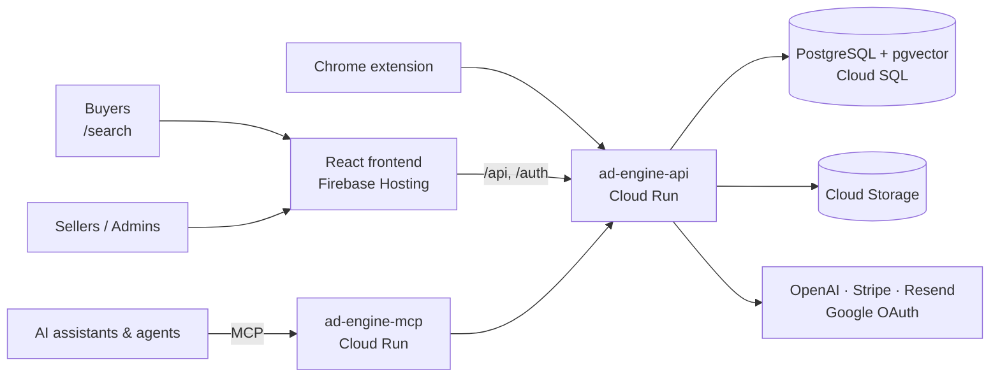

# PinkCurve — AI-Powered Ad Platform

> **Bridge the gap between sellers and buyers through intent-driven, privacy-first AI ad matching.**

Built by Peter Kao Associates · San Jose, CA

---

## Vision

Most online ads miss because they guess what buyers want. PinkCurve reads the buyer's real browsing context and life signals — privately on their device — and matches them with sellers who have exactly what they need, before they even search for it.

**For sellers:** Stop paying for ads that miss. Reach buyers who already need your product — through their real life context, not keyword guessing. Pay only when matched to a genuinely interested buyer.

**For buyers:** Discover products matched to your life — not your identity. Browse entertaining video ads, new arrivals and trending products. Your personal data never leaves your device.

---

## How it fits together



**Full diagrams** — buyer search, seller lifecycle, ad moderation, Creative Studio, MCP and agents, data model and deployment — are in **[docs/ARCHITECTURE.md](docs/ARCHITECTURE.md)**.

---

## Repository layout

| Folder | What it is | README |
|---|---|---|
| [`ad-engine-api`](ad-engine-api) | Node.js/Express API: auth, sellers, products, ads, semantic search, billing, Creative Studio | [README](ad-engine-api/README.md) |
| [`ad-engine-frontend`](ad-engine-frontend) | React 18 + Tailwind seller/admin portal and public buyer search | [README](ad-engine-frontend/README.md) |
| [`ad-engine-mcp`](ad-engine-mcp) | Public MCP server exposing video ads to AI assistants | [README](ad-engine-mcp/README.md) |
| [`ad-engine-agents`](ad-engine-agents) | LangGraph video + email agents (MCP and A2A demo) | [README](ad-engine-agents/README.md) |
| [`ad-engine-landing`](ad-engine-landing) | Static marketing landing page | [README](ad-engine-landing/README.md) |
| [`ad-engine-model`](ad-engine-model) | On-device intent model fine-tuning (Phi-3 + LoRA on MLX) | [README](ad-engine-model/README.md) |
| [`docs`](docs) | Architecture and workflow diagrams | [ARCHITECTURE](docs/ARCHITECTURE.md) |

---

## Live Production URLs

| Service | URL |
|---|---|
| Buyer Search (public) | https://ad-engine-4da45.web.app/search |
| Seller Portal | https://ad-engine-4da45.web.app |
| Landing page | https://pinkcurve-landing.web.app |
| API (Cloud Run) | https://ad-engine-api-610270819686.us-west1.run.app |
| MCP server | https://ad-engine-mcp-610270819686.us-west1.run.app/mcp |

---

## Tech Stack

| Layer | Technology |
|---|---|
| Frontend | React 19 + Tailwind CSS, Recharts |
| Backend | Node.js 20 + Express + Passport.js |
| Database | PostgreSQL 14 + pgvector 0.8.1 (Cloud SQL) |
| AI | OpenAI (GPT-4o mini, GPT-4o, gpt-image-1, text-embedding-3-small, Whisper), BGE reranker (in-process), pluggable LLM providers for Creative Studio |
| Storage | Google Cloud Storage |
| Hosting | Firebase Hosting + Cloud Run |
| Auth | JWT + bcrypt, Google OAuth |
| Payments | Stripe subscriptions (Free / Starter / Pro / Enterprise) |
| Email | Resend |
| Trust & safety | AbuseIPDB, Google Safe Browsing, WhoisXML, IP geolocation |

---

## AI Calls

| # | Model | Where | Purpose |
|---|---|---|---|
| 1 | GPT-4o mini | `POST /api/extension/semantic-match` | Extract intent keywords from the buyer's page context |
| 2 | text-embedding-3-small | `semanticSearch()` in `server.js` | Turn a buyer query into a 1536-dim vector |
| 3 | `Xenova/bge-reranker-base` | `rerankerService.js` | Rerank pgvector candidates (runs inside the API, no API call) |
| 4 | GPT-4o mini (vision) | `moderateImage()` in `server.js` | Moderate seller images and video thumbnails |
| 5 | text-embedding-3-small | `generate-embeddings.js` | Embed ad headline + copy + tags + transcript into pgvector |
| 6 | whisper-1 | `transcriptionService.js` | Transcribe video ads so spoken content is searchable |
| 7 | gpt-image-1 | `POST /api/ads/:id/generate-image` | Generate ad images from a product description |
| 8 | GPT-4o (default) | `creativeStudioService.js` via `llmProvider.js` | Creative Studio: product analysis, campaigns, scripts, storyboards. Provider set by `LLM_PROVIDER` (openai, anthropic, google, nvidia, OpenAI-compatible) |

---

## API Overview

The full route list lives in [`ad-engine-api/README.md`](ad-engine-api/README.md). Main groups:

| Group | Prefix | Auth |
|---|---|---|
| Seller auth | `/auth/*` (register, login, verify-email, Google OAuth) | Public |
| Buyer | `/api/buyer/*` (featured, categories, semantic-match, click, reviews, Google sign-in, email OTP) | Public |
| Chrome extension | `/api/extension/*` | Public |
| Sellers, products, ads | `/api/sellers`, `/api/products`, `/api/ads` | JWT; sellers see only their own data |
| Creative Studio | `/api/creative-studio/*` | JWT |
| Billing | `/api/stripe/*`, `/api/seller/subscription`, `/api/billing/*` | JWT (webhook verified by Stripe signature) |
| Analytics | `/api/analytics/*`, `/api/stats` | JWT |
| Admin | `/api/admin/*` (seller approval, ad review, fraud and geo logs, revenue) | JWT + admin role |

### Role-Based Access Control

| Feature | Admin | Seller |
|---|---|---|
| See all sellers, products, ads | Yes | Own only |
| Buyers page | Yes | Hidden |
| Seller approval and ad review queues | Yes | No |
| Fraud logs, geo verification, revenue | Yes | No |
| Creative Studio | Yes | Yes (own products) |
| Buyer Search demo | Yes | Yes |

Seller/admin JWT: `{ id, email, role: "admin" | "seller", seller_id }`, 7-day expiry. Buyer JWT (buyer Google sign-in): `{ id, email, type: "buyer" }`, 30-day expiry. Both are signed with `SESSION_SECRET`.

---

## Database (29 tables)

| Area | Tables |
|---|---|
| Sellers | `sellers`, `seller_accounts`, `seller_geo_log`, `seller_reviews` |
| Catalog | `products`, `product_embeddings`, `ads`, `ad_categories`, `ad_embeddings`, `ad_moderation_log` |
| Buyers & matching | `buyers`, `buyer_accounts`, `buyer_sessions`, `buyer_geo_log`, `ad_matches`, `match_events`, `ad_events`, `llm_match_logs` |
| Billing | `subscriptions`, `payment_history`, `billing_transactions`, `billing_support_tickets` |
| Creative Studio | `product_knowledge`, `creative_campaigns`, `creative_briefs`, `creative_scripts`, `creative_storyboards` |
| System | `session`, `fraud_logs` |

### Key SQL Patterns

```sql
-- Semantic search (cosine similarity)
SELECT a.*, 1 - (ae.embedding <=> $1::vector) AS similarity_score
FROM ads a
JOIN ad_embeddings ae ON ae.ad_id = a.id
WHERE a.status = 'active'
  AND (1 - (ae.embedding <=> $1::vector)) > 0.35   -- 0.20 when reranking
ORDER BY ae.embedding <=> $1::vector
LIMIT 20;

-- pgvector index (lists=1 for small datasets)
CREATE INDEX idx_ad_embeddings_vec ON ad_embeddings
USING ivfflat (embedding vector_cosine_ops) WITH (lists = 1);

-- ad_matches uses matched_at, NOT created_at
SELECT COUNT(*) FROM ad_matches WHERE matched_at BETWEEN $1 AND $2;

-- Always upsert embeddings
INSERT INTO ad_embeddings (...) VALUES (...)
ON CONFLICT (ad_id) DO UPDATE SET embedding = EXCLUDED.embedding, ...;
```

---

## GCP Infrastructure

| Resource | Detail |
|---|---|
| Project | `ad-engine-4da45` (project number 610270819686) |
| Cloud Run | `ad-engine-api` (2 GiB, us-west1), `ad-engine-mcp` (us-west1) |
| Cloud SQL | `ad-engine-4da45:us-west1:ad-engine-db` (PostgreSQL 14) |
| Firebase Hosting | `ad-engine-4da45.web.app` (app), `pinkcurve-landing.web.app` (landing) |
| GCS Bucket | `ad-engine-media-pka` |
| Secret Manager | `db-password`, `session-secret`, `openai-api-key`, `google-client-id`, `google-client-secret`, `resend-api-key` |
| Google OAuth client | **Separate project `ad-engine-498605`** (client "Ad Engine") |

> Your local `gcloud` default project may not be `ad-engine-4da45`. Always pass `--project=ad-engine-4da45` (the deploy scripts do).

### Deployment

```bash
# API → Cloud Run (builds from the Dockerfile, pins the project)
cd ad-engine-api && ./deploy.sh

# Frontend → Firebase Hosting
cd ad-engine-frontend && npm run build && firebase deploy --only hosting

# MCP server → Cloud Run
cd ad-engine-mcp && gcloud run deploy ad-engine-mcp --source . --region=us-west1 \
  --project=ad-engine-4da45 --allow-unauthenticated --clear-base-image

# Landing page → Firebase Hosting target "landing"
cd ad-engine-landing && firebase deploy --only hosting:landing
```

Deploys are manual; pushing to GitHub does not deploy anything. Cloud Run reads Secret Manager values when a revision starts, so roll a new revision after rotating a secret.

### Working with the production database

```bash
# Start the Cloud SQL proxy, then read the password from Secret Manager (never commit it)
cloud-sql-proxy ad-engine-4da45:us-west1:ad-engine-db --port 5435 &
export PGPASSWORD="$(gcloud secrets versions access latest --secret=db-password --project=ad-engine-4da45)"
psql "host=127.0.0.1 port=5435 dbname=adengine user=adengine"

# Generate embeddings for new ads against production
cd ad-engine-api && DB_HOST=127.0.0.1 DB_PORT=5435 DB_NAME=adengine DB_USER=adengine \
  DB_PASSWORD="$PGPASSWORD" node generate-embeddings.js
```

---

## Local Development

```bash
# API — http://localhost:3001 (reads ad-engine-api/.env)
cd ad-engine-api && npm install && npm start

# Frontend — http://localhost:3000 (REACT_APP_API_URL defaults to http://localhost:3001)
cd ad-engine-frontend && npm install && npm start
```

The local database (PostgreSQL 14 with pgvector on port 5432) holds test data; video ads only exist in production. Credentials go in `ad-engine-api/.env` (see `.env.example`) — never in this README.

---

## Known Gotchas

1. **`ad_matches` uses `matched_at`, not `created_at`.**
2. **Docker images must be `linux/amd64` for Cloud Run.** `deploy.sh` builds in Cloud Build, which handles this; only matters for local `docker build`.
3. **gpt-image-1 returns base64, not a URL** — decode and upload to GCS (`uploadImageToGCS()`). Valid `quality` values: `low`, `medium`, `high`, `auto` (not `standard`).
4. **GPT moderation can return markdown-wrapped JSON** — strip ```` ```json ```` fences before `JSON.parse`.
5. **ivfflat index needs `lists = 1` for small datasets.**
6. **multer must be defined before upload routes** that use `upload.single()` / `upload.fields()`.
7. **New ads aren't searchable until embeddings run** — `node generate-embeddings.js` (new ads) or `--force` (all, with transcripts).
8. **Whisper only accepts files under 25 MB.**
9. **GCS permissions** — the Cloud Run service account needs `objectAdmin` on the bucket:
   ```bash
   gsutil iam ch serviceAccount:610270819686-compute@developer.gserviceaccount.com:objectAdmin gs://ad-engine-media-pka
   ```

---

## Vector Database Scaling Path

Currently pgvector 0.8.1 on Cloud SQL for PostgreSQL 14 with an ivfflat index (`lists = 1`) over ~50 ad embeddings. This is the right choice at current scale.

### Data integrity

Cascade deletes are configured in the schema, so vectors never become orphaned:

```
sellers (delete)
  → products (CASCADE)
      → product_embeddings (CASCADE)
      → ads (CASCADE)
          → ad_embeddings, ad_categories, ad_matches, ad_moderation_log (CASCADE)
  → seller_accounts, subscriptions, payment_history, billing_transactions,
    billing_support_tickets, seller_geo_log (CASCADE)
```

One `DELETE` on `sellers` removes all downstream business data including vectors, which supports GDPR/CCPA "right to be forgotten". Buyers are never linked to sellers by any foreign key, preserving buyer anonymity end-to-end.

### Similarity threshold

`semanticSearch()` filters out weak matches (`> 0.35`, or `> 0.20` when the reranker will re-score candidates). Same-topic ad pairs score ~0.79; unrelated pairs ~0.27. Without a threshold, a query with no relevant ads would still return the "least bad" ones.

### pgvector vs dedicated vector DBs

| | pgvector (current) | Pinecone / dedicated vector DB |
|---|---|---|
| Query syntax | Plain SQL | Proprietary API/SDK |
| Join vectors with relational data | Native — one query joins ads + products + sellers + embedding | Separate lookups merged in app code |
| Cost | Free (Postgres extension) | Paid, scales with usage |
| Good up to | ~1–10M vectors | Billions |

### When to reconsider

| Ad count | Recommendation |
|---|---|
| Up to ~100k | pgvector + ivfflat — no change needed |
| 100k–1M | pgvector + HNSW index |
| 1M+ | AlloyDB for PostgreSQL (ScaNN index, same wire protocol) |
| 10M+ | Dedicated vector DB, accepting the loss of native SQL joins |

---

## Feature Roadmap

### Completed
- JWT + Google OAuth authentication, role-based access (admin/seller)
- Seller self-registration with email verification (Resend) and admin approval queue
- IP fraud scoring (AbuseIPDB) and seller/buyer geo verification
- Product and ad management with image/video upload to GCS
- GPT-4o vision moderation + admin ad review queue
- pgvector semantic search + BGE reranker; Whisper transcripts for video ads
- Public buyer landing page at `/search`, buyer Google sign-in, email OTP, reviews
- Chrome extension with server-side intent extraction
- Stripe subscriptions (Free / Starter / Pro / Enterprise) and billing support tickets
- Analytics dashboard, ad event log, fraud logs
- Creative Studio: product analysis → campaign concepts → scripts → storyboards, per-product workspace
- Public MCP server and LangGraph agents (MCP + A2A demo)

### Planned
- Knowledge tab API (read/write `product_knowledge`) and campaign management
- Automatic embedding generation when an ad goes live
- Discovery feed — Trending, New Arrivals, Deals
- Pay-per-match billing
- Mobile app (iOS/Android) with on-device intent model (see `ad-engine-model`)

---

## Branding

- **Brand name:** PinkCurve
- **Colors:** Pink to Purple gradient `linear-gradient(135deg, #ec4899, #a855f7)`
- **Mission:** Inclusive, privacy-first, trust-based ad marketplace

---

*PinkCurve — Peter Kao Associates — San Jose, CA*
*Built with Claude (Anthropic) as primary AI coding assistant*
