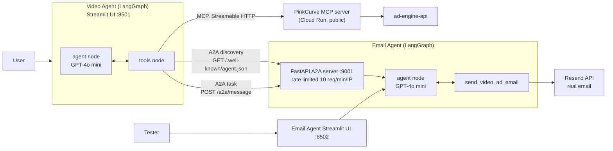
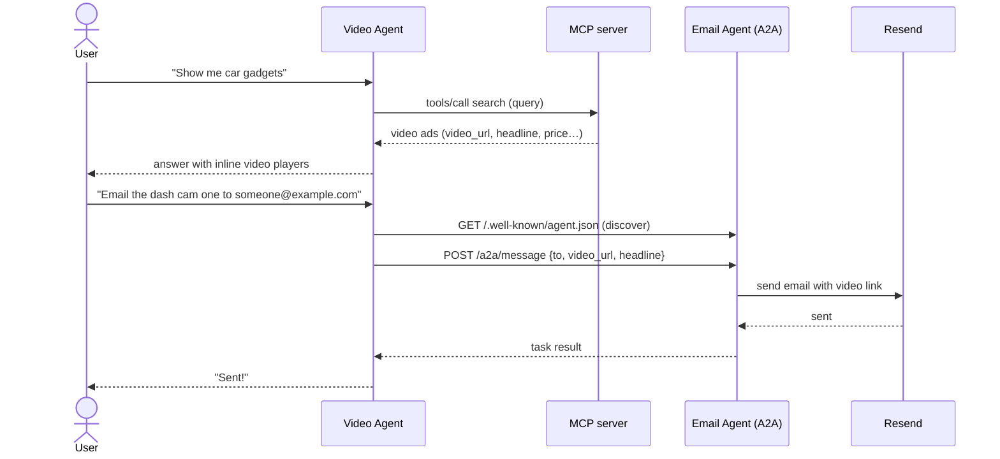

# PinkCurve Multi-Agent Demo (LangGraph + MCP + A2A)

A two-agent system demonstrating agent-to-agent collaboration, built for interview demo purposes. Both agents are independently implemented LangGraph StateGraphs, connected via MCP (agent-to-tool) and a custom A2A-style protocol (agent-to-agent).

## Architecture



### Demo flow



## Components

| File | Purpose |
|---|---|
| `video_agent/streamlit_app.py` | **Video Agent app for Streamlit Community Cloud.** Its own LangGraph StateGraph using the current MCP tool names: `search_video_ads_for_buyer`, `get_featured_video_ads`, `get_video_ads_by_category`, `list_categories`. MCP URL is hard-coded to the production MCP server. Has **no** email (A2A) tool. |
| `video_agent/graph.py` | Original hand-built LangGraph StateGraph used by `chat_ui.py`. Tools: `search_video_ads`, `get_featured_video_ads`, `send_video_ad_via_email` (A2A). Reads `PINKCURVE_MCP_URL` and `EMAIL_AGENT_A2A_URL`. |
| `video_agent/chat_ui.py` | Original local Streamlit chat UI; renders `.mp4` URLs as inline video. |
| `email_agent/graph.py` | LangGraph StateGraph with one tool, `send_video_ad_email`, which sends an email via Resend containing a video ad link. |
| `email_agent/chat_ui.py` | Streamlit chatbot for manually testing the email agent. |
| `email_agent/a2a_server.py` | Exposes the Email Agent over HTTP: `GET /.well-known/agent.json` (Agent Card discovery) and `POST /a2a/message` (task exchange). Port from `A2A_EMAIL_PORT` (default 9001). |

> **Known issue:** the full MCP + A2A demo runs through `graph.py` / `chat_ui.py`, but `graph.py` still calls the MCP tools by their old names (`search_video_ads`, `get_video_ads`). The live MCP server renamed them to `search_video_ads_for_buyer` and `get_featured_video_ads`, so ad searches in that flow fail until `graph.py` is updated. `streamlit_app.py` uses the new names but has no email step.

**Note on A2A implementation:** the official a2a-sdk Python package (tested versions 1.1.0 and 0.2.16) did not expose the AgentExecutor / A2AStarletteApplication classes referenced in public A2A tutorials — both installed versions had a different internal structure (gRPC/database-oriented). Rather than fight an SDK version mismatch, the A2A server here is a small custom FastAPI implementation of the same two core concepts (Agent Card discovery + message-based task exchange), built directly on the protocol spec.

## Why raw StateGraph instead of create_agent

Both agents use LangGraph's StateGraph directly — defining agent and tools nodes and wiring the conditional edges by hand — rather than LangChain's create_agent/create_react_agent convenience wrapper. This was a deliberate choice to demonstrate full control over the agent loop (the classic ReAct pattern: call LLM, check for tool calls, execute tools, loop) for interview purposes, even though create_agent would have been faster to write.

## Setup

```bash
cd ad-engine-agents
python3 -m venv venv
source venv/bin/activate
pip install -r requirements.txt
```

Create a `.env` file (git-ignored) with:

```
OPENAI_API_KEY=your_key
RESEND_API_KEY=your_key
EMAIL_FROM=PinkCurve <onboarding@resend.dev>
PINKCURVE_MCP_URL=https://ad-engine-mcp-610270819686.us-west1.run.app/mcp
EMAIL_AGENT_A2A_URL=http://localhost:9001
```

## Running

Three processes, each in its own terminal:

```bash
# Terminal 1 — Email Agent's A2A server (:9001)
cd email_agent && python a2a_server.py

# Terminal 2 — Video Agent UI (:8501)
cd video_agent && streamlit run chat_ui.py           # full demo incl. email (see known issue)
#            or: streamlit run streamlit_app.py      # search only, current tool names

# Terminal 3 (optional) — Email Agent's own chatbot UI, for manual testing
cd email_agent && streamlit run chat_ui.py --server.port 8502
```

## Tech Stack

- LangGraph — agent state machines (both agents)
- LangChain (langchain-openai) — LLM integration (GPT-4o mini)
- MCP (mcp Python SDK) — Video Agent's connection to PinkCurve's public video ad data
- FastAPI + Uvicorn — custom A2A-style server for the Email Agent
- Streamlit — chatbot UIs
- Resend — transactional email delivery
