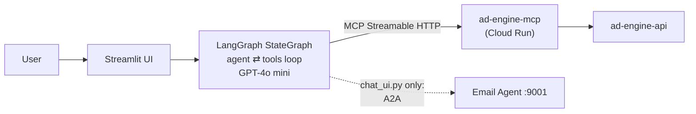

# PinkCurve Video Discovery Agent

A LangGraph-powered video ad discovery assistant that helps users find relevant video ads from PinkCurve sellers, through PinkCurve's public MCP server.

## Features

- Search video ads by keyword/intent
- Browse featured video ads and categories
- Inline video player rendering in chat
- Send video ads via email (A2A, original `chat_ui.py` flow only)

## Architecture



- **LangGraph** — agent orchestration with tool calling
- **MCP** — connects to PinkCurve's Model Context Protocol server
- **OpenAI GPT-4o mini** — language model for understanding queries
- **Streamlit** — chat UI with video rendering

## Files

| File | Description |
|------|-------------|
| `streamlit_app.py` | Main Streamlit app (for Cloud deployment). Tools: `search_video_ads_for_buyer`, `get_featured_video_ads`, `get_video_ads_by_category`, `list_categories`. MCP URL is hard-coded. |
| `chat_ui.py` | Original local chat UI, built on `graph.py` |
| `graph.py` | Original LangGraph agent, including the A2A email tool. Uses outdated MCP tool names (see [../README.md](../README.md)) |
| `requirements.txt` | Python dependencies |
| `.streamlit/secrets.toml.example` | Secrets template |

## Deploy to Streamlit Community Cloud

1. Push the repository to GitHub.
2. Go to [share.streamlit.io](https://share.streamlit.io), click **New app**, and select the repository.
3. Set the main file path to `ad-engine-agents/video_agent/streamlit_app.py` and click **Deploy**.
4. In the app's **Settings → Secrets**, add:

```toml
OPENAI_API_KEY = "sk-your-openai-api-key"
```

| Secret | Description | Required |
|--------|-------------|----------|
| `OPENAI_API_KEY` | Your OpenAI API key | Yes |

`streamlit_app.py` connects to `https://ad-engine-mcp-610270819686.us-west1.run.app/mcp` directly, so no MCP URL secret is needed. (`PINKCURVE_MCP_URL` and `EMAIL_AGENT_A2A_URL` are only read by `graph.py`.)

## Local Development

```bash
cd ad-engine-agents/video_agent
pip install -r requirements.txt
cp .streamlit/secrets.toml.example .streamlit/secrets.toml   # add your OpenAI key
streamlit run streamlit_app.py                                 # http://localhost:8501
```

## Live Deployment

A Streamlit Cloud URL (`https://pinkcurve-video.streamlit.app`) was planned; it currently redirects to a Streamlit sign-in page, so it's either private or not deployed. Update this section once the app is public.
