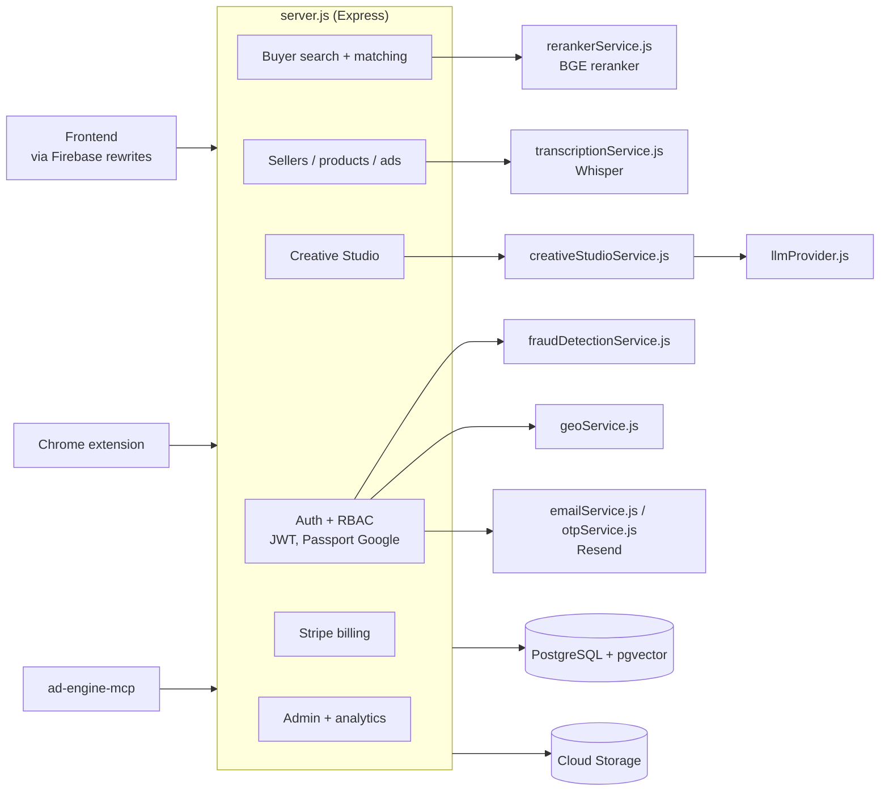

# ad-engine-api

The PinkCurve backend: a Node.js 20 + Express API that owns all business logic and is the only component that talks to the database. Runs on Cloud Run as `ad-engine-api` in project `ad-engine-4da45`.

See [../docs/ARCHITECTURE.md](../docs/ARCHITECTURE.md) for request-flow diagrams.



## Files

| File | Purpose |
|---|---|
| `server.js` | Express app: all routes, DB table bootstrapping, auth, moderation, semantic search (~5,300 lines) |
| `llmProvider.js` | Provider-agnostic structured LLM calls (OpenAI default; Anthropic, Google, NVIDIA, OpenAI-compatible) with retries and timeouts |
| `creativeStudioService.js` | Creative Studio steps: `analyzeProduct`, `generateCampaigns`, `generateScript`, `generateStoryboard`, `evaluateArtifact`, `generateRenderSpec` |
| `creativeStudioSchemas.js` | JSON schemas the Creative Studio LLM outputs are validated against |
| `rerankerService.js` | In-process `Xenova/bge-reranker-base` cross-encoder that re-scores pgvector candidates |
| `transcriptionService.js` | Whisper (`whisper-1`) transcription of video ads; builds embedding text with the transcript |
| `fraudDetectionService.js` | IP fraud scoring (AbuseIPDB) for registrations and buyer activity; blocks at score ≥ 60 |
| `geoService.js` | IP geolocation and client IP detection behind proxies |
| `emailService.js` | Resend emails: verification, seller approved/rejected/suspended, ad approved, match notifications, payment failed |
| `otpService.js` | Buyer email one-time codes (in-memory store) |
| `generate-embeddings.js` | Batch script: embed active ads into `ad_embeddings` (`--force` re-embeds all with transcripts) |
| `bulk-generate-images.js` | One-off script: generate ad images in bulk |
| `migrate-images-to-gcs.js` | One-off script: move base64 images into GCS |
| `tests/llmProvider.test.js` | Tests for `llmProvider.js` |
| `Dockerfile` | `node:20-slim` image, copies only the runtime files above |
| `deploy.sh` | Deploys to Cloud Run (project pinned to `ad-engine-4da45`) |

## Routes

### Auth (seller/admin)
```
POST /auth/register              fraud check → seller (approval_status pending_review) → verification email
GET  /auth/verify-email          marks email_verified; admin approval still required
POST /auth/resend-verification
POST /auth/login                 → { success, user, token }
POST /auth/logout
GET  /auth/me
GET  /auth/google                Google OAuth start
GET  /auth/google/callback       Google OAuth callback (GOOGLE_CALLBACK_URL)
```

### Buyer (public)
```
GET  /api/buyer/featured                 top ads by cost_per_match
GET  /api/buyer/categories               categories with counts
POST /api/buyer/semantic-match           pgvector search (+ BGE rerank), records matches
POST /api/buyer/match                    GPT matching fallback
POST /api/buyer/click
POST /api/buyer/auth/google              buyer Google sign-in (ID token)
POST /api/buyer/verify-email-otp/send | /confirm
GET  /api/buyer/verify-email-otp/status
POST /api/buyer/reviews
GET  /api/reviews/ad/:ad_id | /api/reviews/seller/:seller_id
POST /api/reviews/:review_id/helpful
POST /api/extension/semantic-match       Chrome extension: GPT intent → vector search
POST /api/extension/match
```

### Sellers, products, ads (JWT; sellers see only their own rows)
```
GET/POST        /api/sellers         PUT/DELETE /api/sellers/:id
GET             /api/sellers/my-geo  GET /api/sellers/:id/billing-status
GET/POST        /api/products        PUT/DELETE /api/products/:id
POST            /api/products/:id/upload-image
GET/POST        /api/ads             GET/PUT/DELETE /api/ads/:id
POST            /api/ads/:id/upload-image     GPT-4o mini vision moderation
POST            /api/ads/:id/upload-video     GCS upload, thumbnail moderation, pending_review
POST            /api/ads/:id/generate-image   gpt-image-1
GET             /api/stats
```

### Creative Studio (JWT)
```
POST /api/creative-studio/briefs                      analyze product + campaign concepts
GET  /api/creative-studio/briefs | /briefs/:id
PUT  /api/creative-studio/briefs/:id/select-campaign
POST /api/creative-studio/briefs/:id/script
GET  /api/creative-studio/briefs/:id/scripts
POST /api/creative-studio/scripts/:id/storyboard
GET  /api/creative-studio/scripts/:id/storyboards
PUT  /api/creative-studio/storyboards/:id/status      approve / reject
GET  /api/creative-studio/products/:productId/briefs | /scripts | /storyboards | /stats
```

### Billing (JWT)
```
POST /api/stripe/create-checkout-session
POST /api/stripe/webhook                 Stripe-signed, no JWT
GET  /api/seller/subscription            POST /api/seller/subscription/cancel
GET  /api/seller/payments
GET/POST /api/billing/support-tickets
```

### Analytics (JWT)
```
GET /api/analytics/overview | spend-trend | top-sellers | top-ads | ads-by-format
GET /api/analytics/ads-by-category | buyers-by-platform | sellers-by-plan | buyer-trend
```

### Admin (JWT + admin role)
```
GET  /api/admin/sellers/pending | /sellers/pending/count
PUT  /api/admin/sellers/:id/approve | reject | suspend | unsuspend
GET  /api/admin/pending-ads
POST /api/admin/ads/:id/approve | reject
POST /api/admin/retranscribe-ads          Whisper + re-embed all active video ads
GET  /api/admin/fraud-logs | seller-geo-logs | buyer-geo-logs | seller-login-history/:id
GET  /api/admin/ad-events | registered-buyers | revenue
POST /api/admin/buyers/:id/ban | unban
GET  /api/buyers
```

## Environment variables

Local development reads `.env` (copy `.env.example`). Production values are set on the Cloud Run service; secrets come from Secret Manager. `.env.production` is a local, git-ignored mirror of production — never commit it.

| Variable | Required | Notes |
|---|---|---|
| `DB_HOST`, `DB_PORT`, `DB_NAME`, `DB_USER`, `DB_PASSWORD` | Yes | `DATABASE_URL` is **not** supported. Production uses `/cloudsql/ad-engine-4da45:us-west1:ad-engine-db` |
| `SESSION_SECRET` | Yes | Signs JWTs and sessions |
| `OPENAI_API_KEY` | Yes | Embeddings, moderation, Whisper, gpt-image-1, Creative Studio default |
| `CLIENT_URL` | Yes | Frontend origin for CORS and OAuth redirects (`https://ad-engine-4da45.web.app`) |
| `GCP_PROJECT_ID`, `GCP_BUCKET_NAME` | Yes | Media storage (`ad-engine-media-pka`) |
| `RESEND_API_KEY`, `EMAIL_FROM` | Yes | Email |
| `STRIPE_SECRET_KEY`, `STRIPE_PUBLISHABLE_KEY`, `STRIPE_WEBHOOK_SECRET` | For billing | |
| `GOOGLE_CLIENT_ID`, `GOOGLE_CLIENT_SECRET`, `GOOGLE_CALLBACK_URL` | For Google sign-in | Callback in production: `https://ad-engine-4da45.web.app/auth/google/callback`. The OAuth client is in GCP project `ad-engine-498605` |
| `ABUSEIPDB_API_KEY`, `GOOGLE_SAFE_BROWSING_KEY`, `WHOISXML_API_KEY` | Optional | Fraud and URL checks |
| `LLM_PROVIDER`, `LLM_MODEL`, `LLM_TEMPERATURE`, `LLM_TIMEOUT`, `LLM_MAX_RETRIES`, `LLM_BASE_URL` | Optional | Creative Studio provider (default `openai` / `gpt-4o`) |
| `ANTHROPIC_API_KEY`, `GOOGLE_AI_API_KEY`, `NVIDIA_API_KEY` | Optional | Only for the matching `LLM_PROVIDER` |
| `MCP_SERVICE_TOKEN` | Optional | Bearer token for machine-to-machine access to protected routes |
| `SUPPORT_EMAIL`, `TEST_EMAIL` | Optional | Billing support inbox; test recipient |
| `GCP_KEY_FILE` | Local only | Service-account key path; leave empty on Cloud Run |
| `PORT` | Optional | Defaults to 3001 locally; Cloud Run sets 8080 |

## Run locally

```bash
npm install
cp .env.example .env     # fill in values
npm start                # http://localhost:3001
```

## Embeddings

New ads are **not** searchable until they have an embedding:

```bash
node generate-embeddings.js           # embed ads that don't have one yet
node generate-embeddings.js --force   # re-embed all ads (with Whisper transcripts)
```

Always upsert with `ON CONFLICT (ad_id) DO UPDATE`. Video transcription needs `OPENAI_API_KEY` and files under 25 MB. To run against production, see "Working with the production database" in the [root README](../README.md).

## Deploy

```bash
./deploy.sh    # gcloud run deploy --source . --project ad-engine-4da45, builds from Dockerfile
```

Creative Studio tables (`product_knowledge`, `creative_campaigns`, `creative_briefs`, `creative_scripts`, `creative_storyboards`) are created on demand by `ensureCreativeStudioTables()` with `CREATE TABLE IF NOT EXISTS`, so a deploy is enough to roll out new ones. Changing an existing table's columns needs an explicit `ALTER TABLE`.
