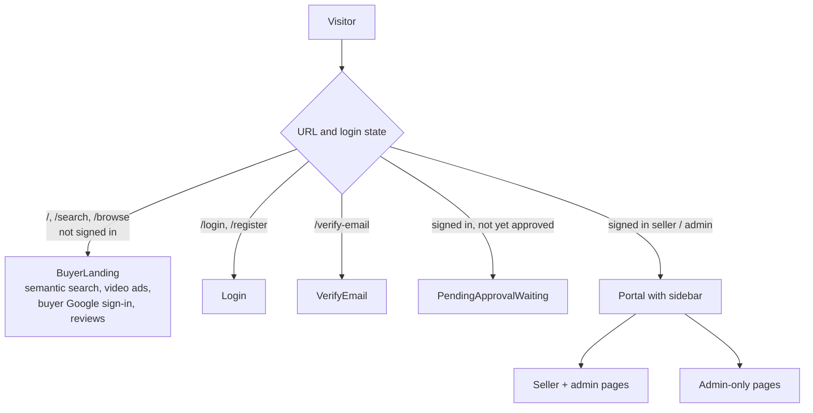

# ad-engine-frontend

The PinkCurve web app: a React 19 + Tailwind CSS single-page app with two faces.

- **Public buyer search** at `/`, `/search` and `/browse` (`BuyerLanding.jsx`) for visitors who aren't signed in.
- **Seller / admin portal** after login, with a sidebar whose pages depend on the user's role.

Hosted on Firebase Hosting (`ad-engine-4da45.web.app`). See [../docs/ARCHITECTURE.md](../docs/ARCHITECTURE.md) for how it talks to the API.



## Pages

Navigation is state-based in `src/App.js` (`ALL_NAV` and `PAGES`), not React Router. Admin-only pages are also blocked in code if a seller tries to open them.

| Page | File | Who |
|---|---|---|
| Dashboard | `pages/Dashboard.jsx` | Admin, seller |
| Products | `pages/Products.jsx` | Admin, seller (own) |
| Ads | `pages/Ads.jsx` | Admin, seller (own) |
| Creative Studio | `pages/CreativeStudio.jsx`, `CreativeStudioDashboard.jsx`, `ProductWorkspace.jsx` | Admin, seller |
| Analytics | `pages/Analytics.jsx` | Admin, seller |
| Billing | `pages/Billing.jsx` (Stripe plans, payments, support tickets) | Seller |
| Pending Approval | `pages/PendingApproval.jsx` (seller approval queue) | Admin |
| Sellers | `pages/Sellers.jsx` | Admin |
| Buyers | `pages/Buyers.jsx` | Admin |
| Ad Event Log | `pages/AdEventLog.jsx` | Admin |
| Geo Verification | `pages/GeoVerification.jsx` | Admin |
| Fraud Logs | `pages/FraudLogs.jsx` | Admin |
| Buyer search demo | `pages/BuyerSearch.jsx` | Not currently in the sidebar |

### Creative Studio product workspace

`ProductWorkspace.jsx` shows one product with tabs from `pages/workspace/`:

| Tab | File | Status |
|---|---|---|
| Overview | `OverviewTab.jsx`, `ProductStatusCard.jsx` | Working |
| Knowledge | `KnowledgeTab.jsx` | UI only — the `product_knowledge` table exists but no API reads or writes it yet |
| Campaigns | `CampaignsTab.jsx` | Working (briefs and campaign concepts) |
| Assets | `AssetsTab.jsx` | Working (scripts and storyboards, approve/reject) |

## Other source files

| File | Purpose |
|---|---|
| `src/auth/AuthContext.jsx` | Login state, JWT in `localStorage`, `authFetch`, Google sign-in redirect |
| `src/api/client.js` | API client that adds the bearer token |
| `src/components/UI.jsx` | Shared UI components |
| `firebase.json` | Hosting config: `/api/**`, `/auth/**` and `/health` are rewritten to the `ad-engine-api` Cloud Run service |

## Configuration

| Variable | Where | Value |
|---|---|---|
| `REACT_APP_API_URL` | `.env.production` | `https://ad-engine-4da45.web.app` — calls go through the Firebase rewrites to Cloud Run |
| `REACT_APP_API_URL` | not set locally | Defaults to `http://localhost:3001` |

`REACT_APP_*` values are baked into the build, so rebuild after changing them.

## Develop

```bash
npm install
npm start          # http://localhost:3000, expects the API on http://localhost:3001
```

## Build and deploy

```bash
npm run build
firebase deploy --only hosting     # project ad-engine-4da45 (from .firebaserc / firebase use)
```

The build shows some ESLint warnings (unused variables, React hook dependency hints). They don't block the build.
