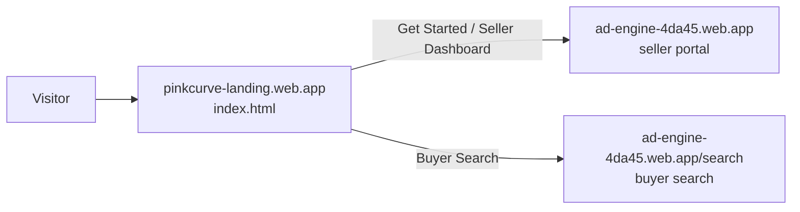

# ad-engine-landing

The PinkCurve marketing page: a single static `index.html` (no build step) that introduces the product and links sellers to the portal and buyers to search.

Live at **https://pinkcurve-landing.web.app**.



## Files

| File | Purpose |
|---|---|
| `index.html` | The whole page: inline CSS, Google Fonts (DM Serif Display, Inter) |
| `firebase.json` | Hosting target `landing`, serves this folder (except `README.md`), 1-hour cache |
| `.firebaserc` | Maps target `landing` → Firebase site `pinkcurve-landing` in project `ad-engine-4da45` |

## Edit and preview

Open `index.html` directly in a browser, or serve the folder:

```bash
npx serve .
```

## Deploy

```bash
firebase deploy --only hosting:landing
```

This deploys only the landing site. It doesn't touch the main app at `ad-engine-4da45.web.app`, which is deployed from `ad-engine-frontend`.
