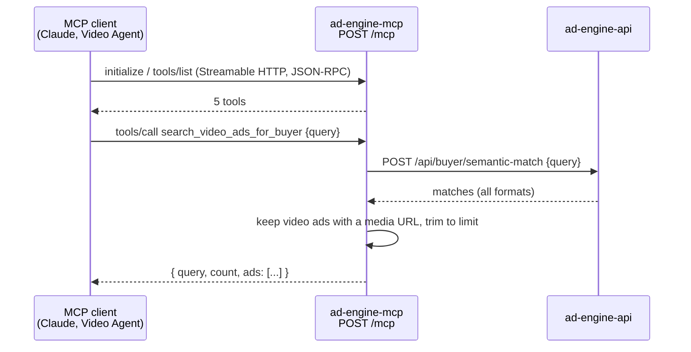

# PinkCurve Video Ads MCP Server

A public Model Context Protocol (MCP) server that lets any MCP-compatible AI assistant (Claude, etc.) retrieve and search video ads from PinkCurve (https://ad-engine-4da45.web.app), an AI-powered buyer-intent ad-matching platform.

## Public Server URL

https://ad-engine-mcp-610270819686.us-west1.run.app/mcp

No authentication required — this wraps PinkCurve's public buyer-facing ad endpoints.

## Connecting from an MCP Host

Add a remote MCP connector pointing to the URL above using the Streamable HTTP transport. In Claude.ai / Claude Desktop, this is typically done via Settings → Connectors → Add custom connector, pasting in the URL.

## Available Tools

Server name: `pinkcurve-video-ads`, version 2.0.0. Five tools are registered.

Ad-returning tools only include ads with `format = video` and a media URL. Each ad has: id, headline, body_copy, video_url, thumbnail_url, product_title, price, currency, category, seller_name, intent_tags.

### get_featured_video_ads
Get currently featured video ads. Use for browsing when the user has no specific intent.

Parameters:
- limit (optional, integer, 1-20): max number of ads to return. Default 10.

Backend: `GET /api/buyer/featured`

Returns: `{ featured: true, count, ads: [...] }`

### search_video_ads_for_buyer
Search video ads by buyer intent using semantic matching.

Parameters:
- query (required, string): what the buyer is looking for (e.g. "wireless car diagnostics tool")
- limit (optional, integer, 1-20): max number of results. Default 6.

Backend: `POST /api/buyer/semantic-match`

Returns: `{ query, count, ads: [...] }`

### get_video_ads_by_category
Get video ads filtered by category (case-insensitive substring match on the ad's category).

Parameters:
- category (required, string): e.g. "Automotive", "Fashion & Apparel", "Jewelry & Accessories"
- limit (optional, integer, 1-20): max number of results. Default 6.

Backend: `GET /api/buyer/featured`, filtered in the MCP server

Returns: `{ category, count, ads: [...] }`

### get_ad_details
Get details for one ad by ID.

Parameters:
- ad_id (required, UUID string)

Backend: `GET /api/buyer/featured`, looked up in the MCP server. Only ads in the featured list can be found.

Returns: a single ad object (same fields as above).

### list_categories
List all available ad categories.

Parameters: none

Backend: `GET /api/buyer/categories`

Returns: `{ categories: [...] }`

## Architecture

This server is a thin, stateless wrapper: it calls PinkCurve's existing public API (ad-engine-api, the same backend powering the buyer search page at https://ad-engine-4da45.web.app/search) and reshapes the response for MCP tool calls. It has no database access and no authentication. It runs as its own Cloud Run service (`ad-engine-mcp`, project `ad-engine-4da45`), independent of the main API.



Each request creates a fresh `McpServer` and `StreamableHTTPServerTransport` (stateless mode). `GET /health` returns `{ status: "ok" }`.

Known limitation: `get_video_ads_by_category` and `get_ad_details` filter the **featured** list (`/api/buyer/featured`), so ads that aren't featured can't be found by category or ID.

## Local Development

```bash
cd ad-engine-mcp
npm install
node server.js
```

Server listens on port 8080 by default (configurable via `PORT`). Set `PINKCURVE_API_URL` to point at a different backend (e.g. `http://localhost:3001` during development); it defaults to the production API.

Quick check:

```bash
curl -s http://localhost:8080/mcp -X POST \
  -H 'Content-Type: application/json' -H 'Accept: application/json, text/event-stream' \
  -d '{"jsonrpc":"2.0","id":1,"method":"tools/list"}'
```

## Deployment

```bash
# IMPORTANT: --clear-base-image forces a Dockerfile build (prevents Buildpacks issues).
# --project is required because the local gcloud default project may be different.
gcloud run deploy ad-engine-mcp --source . --region=us-west1 \
  --project=ad-engine-4da45 --allow-unauthenticated --clear-base-image
```
