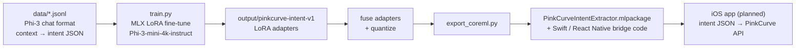

# ad-engine-model

Experiments toward PinkCurve's **on-device intent extractor**: a small language model, fine-tuned to read private device context (emails, notes, browsing) and output only anonymous shopping intent, so personal data never leaves the buyer's phone.

Today the API does this step server-side with GPT-4o mini (`POST /api/extension/semantic-match`). This folder is the path to moving it on-device. It is **not used in production**.



## Output format

The model is trained to return only:

```json
{ "intent": "...", "keywords": ["..."], "category": "...", "urgency": "low|medium|high", "budget_hint": "... or null" }
```

## Files

| Path | Purpose |
|---|---|
| `data/train.jsonl`, `data/valid.jsonl`, `data/eval.jsonl` | Training examples (25 / 5 / 5) in Phi-3 chat format |
| `data/*_mlx.jsonl` | Same data converted by `train.py` for `mlx_lm` |
| `train.py` | Checks MLX and data, converts the data, runs `mlx_lm lora` (16 layers, rank 8, 200 iterations), then test-generates |
| `export_coreml.py` | Exports the fused model to Core ML and writes Swift and React Native inference helpers |
| `output/` | Adapters and exports (git-ignored) |
| `venv/` | Local Python environment (git-ignored) |

## Run

Requires an Apple Silicon Mac.

```bash
cd ad-engine-model
python3 -m venv venv && source venv/bin/activate
pip install mlx-lm coremltools
python train.py           # fine-tune, writes output/pinkcurve-intent-v1
python export_coreml.py   # needs a fused model in output/pinkcurve-intent-v1-fused
```

The dataset is a small proof of concept (35 examples). Expect to grow it substantially before the model is useful.
