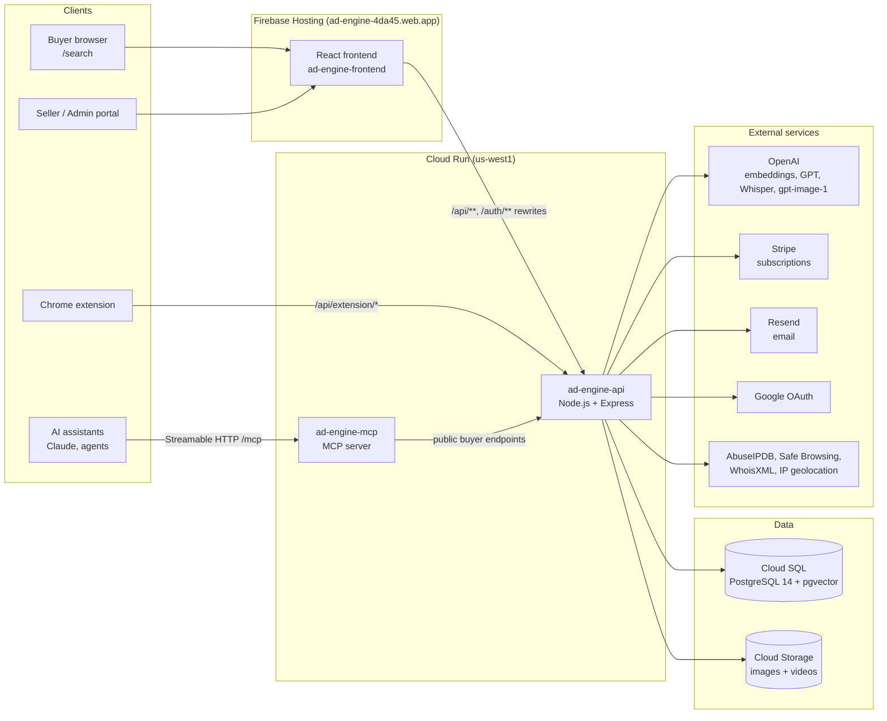
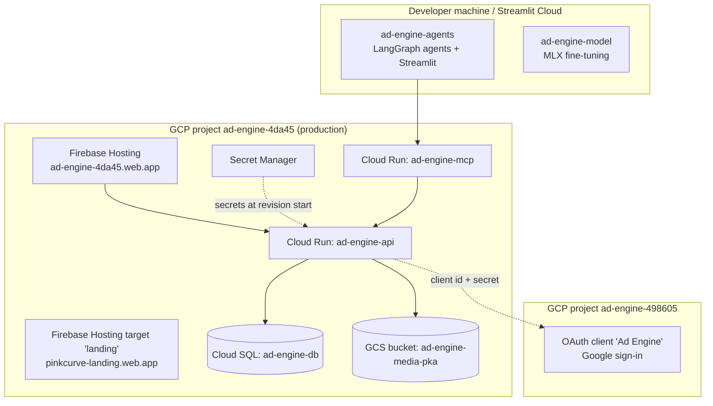
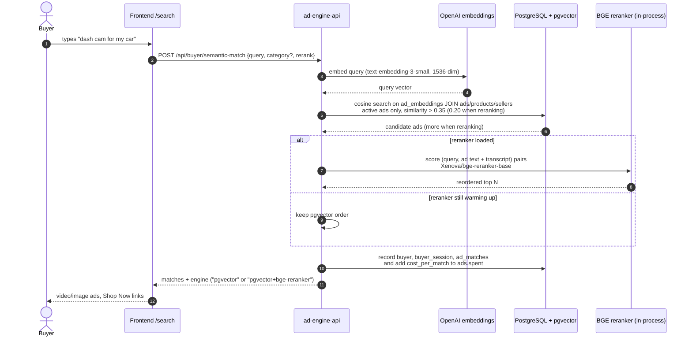
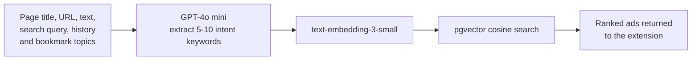
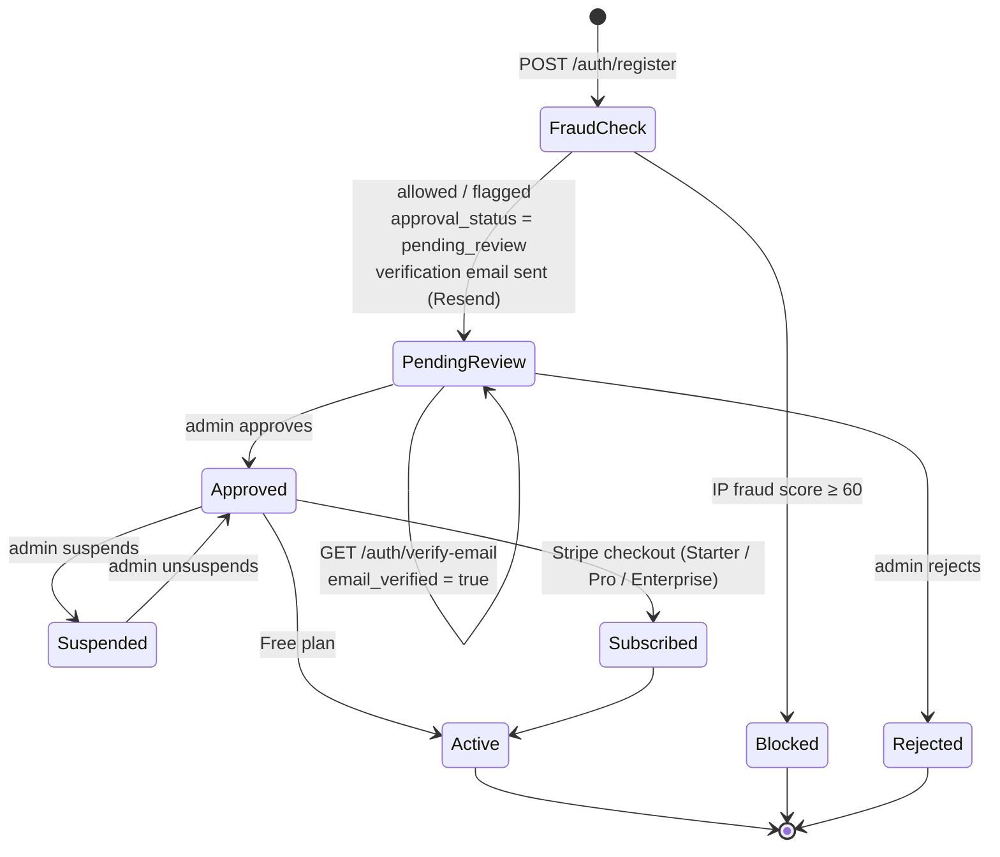
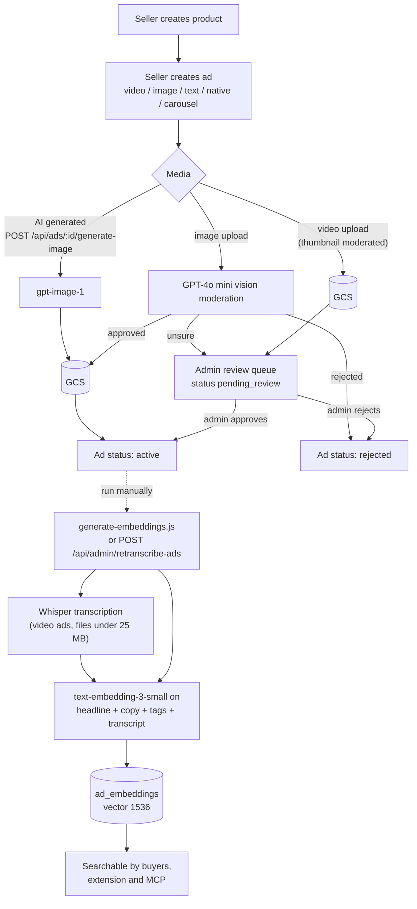
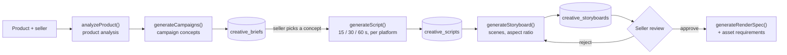
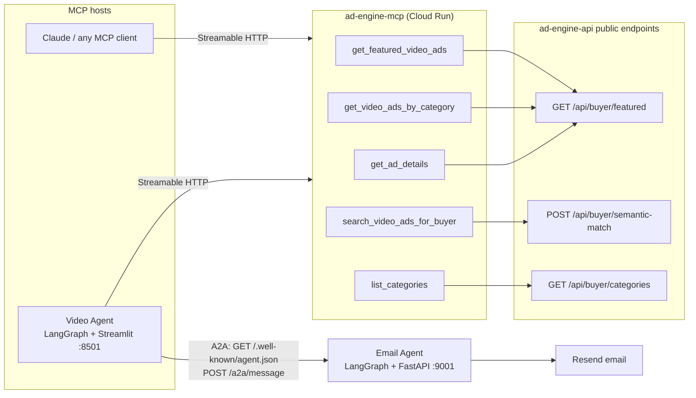
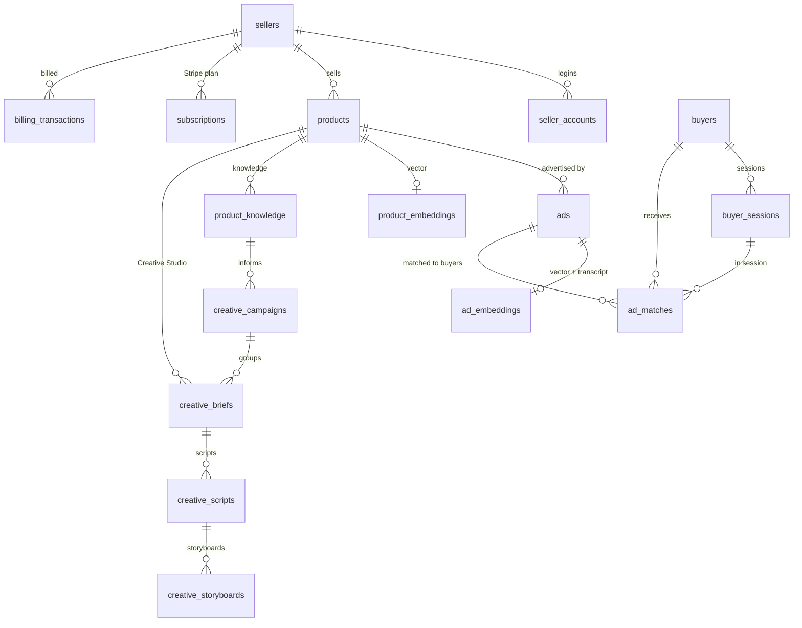
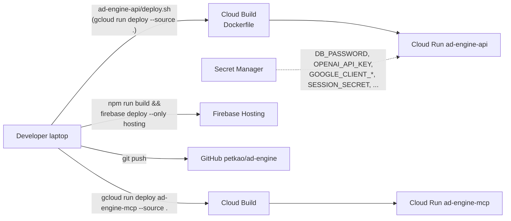

# PinkCurve Architecture

How the pieces of this repo fit together and how requests flow through them. All diagrams are [Mermaid](https://mermaid.js.org/) and render directly on GitHub.

- [1. System overview](#1-system-overview)
- [2. Where everything runs](#2-where-everything-runs)
- [3. Buyer search: semantic matching](#3-buyer-search-semantic-matching)
- [4. Chrome extension: intent from browsing context](#4-chrome-extension-intent-from-browsing-context)
- [5. Seller lifecycle: sign-up to live ad](#5-seller-lifecycle-sign-up-to-live-ad)
- [6. Ad creation, moderation and embeddings](#6-ad-creation-moderation-and-embeddings)
- [7. Creative Studio pipeline](#7-creative-studio-pipeline)
- [8. MCP server and AI agents](#8-mcp-server-and-ai-agents)
- [9. Data model](#9-data-model)
- [10. Deployment](#10-deployment)

---

## 1. System overview

The **API is the only component that talks to the database**. The frontend, the Chrome extension and the MCP server all go through it. Firebase Hosting rewrites `/api/**`, `/auth/**` and `/health` on the site's own domain to the `ad-engine-api` Cloud Run service, so the browser only ever talks to `ad-engine-4da45.web.app`.

## 2. Where everything runs

| Folder | What it is | Runs on |
|---|---|---|
| `ad-engine-api` | Express API, all business logic | Cloud Run `ad-engine-api` |
| `ad-engine-frontend` | React seller/admin portal and public buyer search | Firebase Hosting `ad-engine-4da45` |
| `ad-engine-mcp` | Public MCP server wrapping buyer endpoints | Cloud Run `ad-engine-mcp` |
| `ad-engine-agents` | LangGraph video and email agents (MCP + A2A demo) | Local / Streamlit Community Cloud |
| `ad-engine-landing` | Static marketing page | Firebase Hosting target `landing` |
| `ad-engine-model` | On-device intent model fine-tuning (Phi-3 + LoRA) | Local Apple Silicon |

> The Google OAuth client lives in a **different** GCP project (`ad-engine-498605`) from everything else. Redirect URIs and client secrets are managed there.

## 3. Buyer search: semantic matching

`POST /api/buyer/semantic-match` — used by the public `/search` page and by the MCP server.

Video ads are transcribed with Whisper and the transcript is stored with the embedding, so spoken content is searchable too.

## 4. Chrome extension: intent from browsing context

`POST /api/extension/semantic-match` — the extension sends page context instead of a typed query.

The long-term plan (see `ad-engine-model`) is to run the intent extraction on-device with a fine-tuned small model, so browsing context never leaves the buyer's device.

## 5. Seller lifecycle: sign-up to live ad

- Sign-in: email + password (bcrypt + JWT) or Google OAuth (`/auth/google` → `/auth/google/callback`).
- Every seller login records IP geolocation (`seller_geo_log`) for location verification.
- Stripe webhooks (`POST /api/stripe/webhook`) keep `subscriptions` and `payment_history` in sync.

## 6. Ad creation, moderation and embeddings

> Embeddings are **not** created automatically when an ad goes live. A new ad only becomes searchable after `node generate-embeddings.js` (new ads) or the admin re-transcribe endpoint runs. Both upsert with `ON CONFLICT (ad_id) DO UPDATE`.

## 7. Creative Studio pipeline

AI-assisted ad creation, per product. Each step is a structured LLM call through `llmProvider.js` (OpenAI by default; Anthropic, Google, NVIDIA or any OpenAI-compatible endpoint via `LLM_PROVIDER`), validated against the schemas in `creativeStudioSchemas.js`.

The product workspace UI (`ProductWorkspace.jsx`) groups this per product in **Overview**, **Knowledge**, **Campaigns** and **Assets** tabs. `product_knowledge` and `creative_campaigns` tables exist and briefs/scripts/storyboards carry an optional `campaign_id`, but no API reads or writes `product_knowledge` yet.

## 8. MCP server and AI agents

The MCP server is a thin, stateless wrapper with no database access and no authentication; it only filters to video ads and reshapes responses.

## 9. Data model

Core foreign-key relationships (29 tables in production; logs and other supporting tables are omitted here).

Deleting a seller cascades to products, ads, embeddings, matches and billing rows. Buyers are never linked to sellers by a foreign key, which keeps buyers anonymous.

## 10. Deployment

- Deploys are manual from a laptop; there is no CI/CD pipeline and pushing to GitHub does not deploy anything.
- Cloud Run reads Secret Manager values only when a revision starts. After rotating a secret, roll a new revision.
- Always target project `ad-engine-4da45` (`deploy.sh` pins it). The local gcloud default project may be different.
